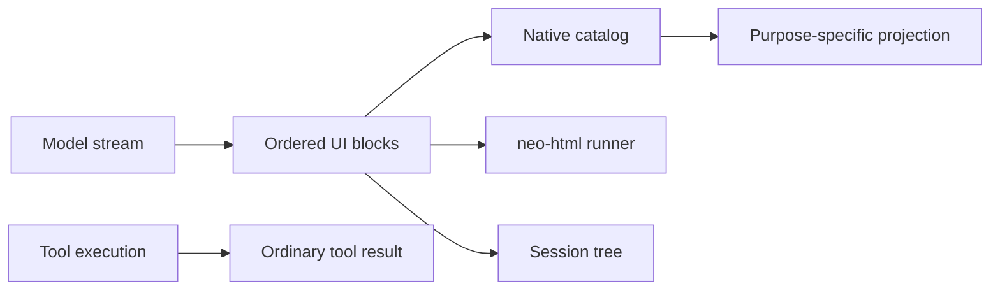
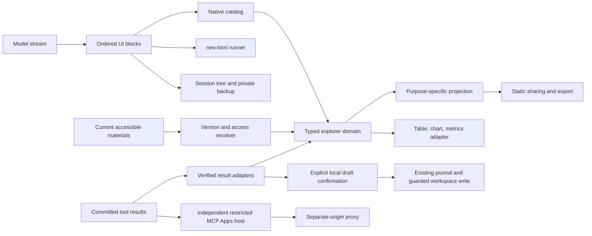

# Intelligent UI expansion implementation record

> Historical design record. For the current unified fence, SDK chat actions,
> resource policy and context behavior, see [Intelligent UI](intelligent-ui.md).
> Earlier names and local-only restrictions below are superseded.

Date: 2026-10-10. Implements the approved expansion requirements against the
current working tree and dependencies. Preserve earlier uncommitted work.

## Phase plan and acceptance

1. **G0 compatibility:** preserve unsupported UI payloads without executing or
   exposing them; retain current v1 behavior. Test backup normalization and static
   projection, unknown versions, state writes, copying and sync safeguards.
2. **G1 linked exploration:** bounded typed datasets, CSV/JSON import, registered
   calculations, table/chart/metrics in one native explorer, consistent projections
   and localized validation. Test the travel fixture (500/340/700; three nights,
   budget 600, selected b costs 460 and 230 per person), invalid DAG/types/units,
   capacity limits, private selection and restoration.
3. **G2 source traceability:** host-created source bindings and immutable data
   context; adapters for existing materials/results and report versions; source
   access/retention checks in rendering and projection. Test forged references,
   version changes, revoked access, copied sessions and evidence immutability.
4. **G3 tool interfaces:** allowlisted structured-result views with stable result
   identity, explicit refresh/draft and a confirmed recoverable local workspace
   action through existing policy/execution. Test malformed results, no automatic
   calls, stale confirmations, double dispatch and unknown-effect recovery.
5. **G4 restricted MCP Apps:** separately review SDK/resource/transport contracts,
   build an independently configured cross-origin host with minimal capabilities,
   default off, static fallback when deployment prerequisites are absent. Do not
   expand neoUi permissions. Test protocol/identity/resource/teardown and denied
   actions; actual browser/deployment acceptance remains explicitly unverified.
6. **Integration:** update prompt fixtures, three locales, user/docs and bilingual
   README. Run targeted tests then imports, formatting, hygiene, lint, typecheck,
   full Vitest, Next build and Worker build. Review cross-module privacy, state and
   authority seams before reporting completion.

G3b starts with a recoverable local action; arbitrary external writes and G4b
network/navigation expansion remain disabled under the documented conservative
scope. No E2E, browser preview, live-provider requests, deployment or git commit.
No build-size gate. Stop task-owned processes at completion.

## Evidence and limitations

Unit and JSDOM coverage does not establish browser isolation, real-model quality,
production CSP or deployment. Final integrated evidence is recorded below.

## Architecture before and after

Before, individual native blocks owned independent datasets. Static projection
and native presentation already shared capability rules; HTML used a separate
sandbox. Ordinary tool results had no typed interactive adapter.

After, one bounded explorer domain supplies its table, chart and computation
results. Source resolution remains a host adapter over current stores; persisted
bindings are not authorization. Tool descriptors are captured only after a tool
result is finalized and checked. MCP Apps uses an independent host, not an extra
neoUi method. Definitions, local state and imported replacements still live in
the existing session tree; private quarantine preserves unsupported future data.

## Decisions and delivery boundaries

- Explorer limits: 1 MiB, 1,000 rows, 20 columns, 16 calculation nodes. Import
  requires preview, type validation and explicit column mapping. No eval, arbitrary
  formula engine, automatic tool calls or dynamic component registration.
- The original public projection ignores private imported replacements. Current
  output uses selected rows and visible fields. Source metadata is independently
  projected; source hashes and aliases never substitute for access checks.
- Tool refresh stages an editable request in chat. This deliberately uses the
  existing user-send/tool-permission flow rather than silently rerunning a tool.
- The first confirmed operation is a create-only local workspace Markdown draft,
  with current Agent/workspace authorization and durable operation outcome. No
  third-party write adapter is enabled.
- MCP Apps uses fixed `ext-apps@1.7.5` with the current MCP SDK. The lockfile was
  synchronized to the user's existing dependency declarations; no dependency
  downgrade was introduced. The display-only profile omits arguments and hidden
  metadata and does not promise support for every App. Default off, independent
  origin mandatory; browser and deployment acceptance remain outstanding.
- The explorer release switch suppresses native explorer generation and live
  interaction while retaining static compatibility. Existing supported tool
  result views are independently gated by the Intelligent UI user setting.

## Integration review

Independent review found real storage-envelope handling, intermediate monetary
precision, source-authority invalidation and message serialization boundary gaps.
Fixes have targeted regression coverage. The main integration also preserves
newer tool selection revisions across both streaming output blocks and final
message tool-call arrays. See final verification below for completed commands;
prior baseline results are not counted as this run's evidence.

## Final verification — 2026-10-10

| Check                                  | Result                                   |
| -------------------------------------- | ---------------------------------------- |
| `check:imports`                        | Passed                                   |
| `format:check`                         | Passed                                   |
| `hygiene:artifacts`                    | Passed                                   |
| `lint`                                 | Passed                                   |
| `typecheck`                            | Passed                                   |
| `test`                                 | 440 files, 3,061 tests passed            |
| `build`                                | Next.js production build passed          |
| `build:worker`                         | OpenNext Cloudflare Worker build passed  |
| Independent MCP sandbox Worker dry-run | Passed in the MCP implementation subtask |
| `git diff --check`                     | Passed                                   |

Integration regression fixes also cover ordinary session duplication without
unnecessary asynchronous source loading, exact source alias remapping after a
copy, historical snapshot-only evidence identities, and independently copied
state in tool-only messages. PDF/image jobs resolve authorized static projections
before starting their existing rendering/export pipeline. Source data imported
later does not change the original output's provenance label.

The main agent integrated and ran project-level verification. Bounded worker and
Astra subtasks handled compatibility, explorer, sources, tools and MCP hosting;
Sol independently reviewed runtime/privacy/authority boundaries and rechecked the
historical evidence-copy correction. No implementation subtask retained a preview
server or background service. No Docker images were built.

Not run: browser/E2E, real-provider output-quality evaluation, live MCP App
interoperability, deployed origin/CSP/navigation isolation, production rollout, or
git commit. The MCP host remains experimental and default-off. HTML/MCP browser
isolation and deployment acceptance are still release conditions, not implied by
unit tests or successful bundles. Arbitrary external writes and expanded MCP
capabilities are outside the delivered restricted profile.
