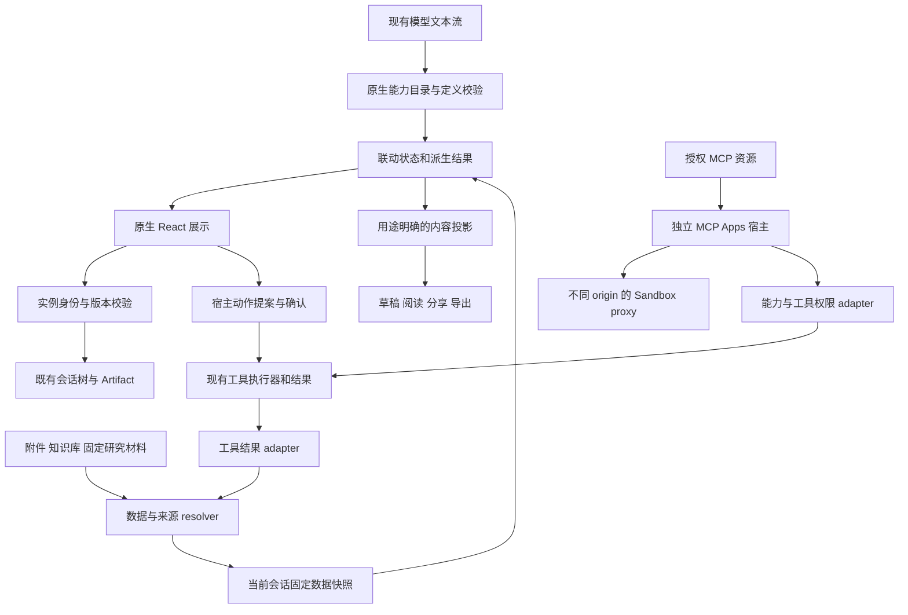

# Neo Chat 智能界面后续拓展开发需求文档

> Historical design record. For the current unified fence, SDK chat actions,
> resource policy and context behavior, see [Intelligent UI](intelligent-ui.md).
> Earlier names and local-only restrictions below are superseded.

文档版本：1.0。编制日期：2026-10-10。状态：待实施的需求规格。

本规格基于当前工作区的智能界面实现，规定下一阶段的产品能力、技术契约和验收条件。建议按“数据探索与计算联动 → 来源可追踪的交互解释 → 工具结果交互展示 → 独立 MCP Apps 宿主”的顺序交付。每一阶段必须形成可单独使用、验证和回退的功能闭环。

本文中的新增字段、模块名称、限制和性能指标是开发目标，并非现有能力或已经完成的验证。本文授权范围是需求编制；不代表开始功能开发、调用外部工具写入、执行 E2E 或部署。

## 1 目标与范围

### 1.1 产品目标

让用户在一条回答中完成“查看数据、调整条件、理解变化、核对来源、选定结果、继续讨论”。优先减少重复复制数据和反复请求模型，同时保持内容、权限与外部副作用可解释。

| 用户任务               | 当前能力                     | 后续目标                                             |
| ---------------------- | ---------------------------- | ---------------------------------------------------- |
| 比较三种出行方案       | 比较、图表、计算器可分别操作 | 同一数据版本驱动表格、图表和费用计算，选定后带入对话 |
| 理解附件或研究报告     | 独立交互解释，消息级来源     | 查看具体数值对应的文件、报告版本和定位信息           |
| 探索工具返回的列表     | 工具日志和文字结果           | 将已完成结果投影为可筛选、排序、比较的原生界面       |
| 使用工具提供的应用界面 | 普通 MCP 工具接入            | 通过独立 MCP Apps 宿主读取资源、协商能力并受控运行   |

### 1.2 开发优先级

| 阶段 | 范围                             | 优先级       | 依赖                    |
| ---- | -------------------------------- | ------------ | ----------------------- |
| G0   | 扩展兼容、数据契约、发布验证准备 | 必须先完成   | 当前实现                |
| G1   | 数据探索与计算联动，一个完整场景 | P0           | G0                      |
| G2   | 宿主绑定来源版本，交互解释可追踪 | P0           | G1 的数据契约           |
| G3a  | 已有工具结果的只读交互展示       | P1           | G1、G2                  |
| G3b  | 宿主确认后的工具操作             | P2，独立交付 | G3a、现有权限与执行日志 |
| G4a  | 独立 MCP Apps 宿主，受限能力配置 | P2，独立交付 | G0、G2、G3a 及部署条件  |
| G4b  | 更多 App 能力和受控外部操作      | P3，后续评审 | G3b、G4a                |

G4a 可以在不启用 G3b 写操作的情况下交付。G3b 和 G4b 的详细行为在本文中定义，但应在各阶段实施前确认范围；不会因完成只读展示而自动开放外部写入。

### 1.3 保持的产品约束

- 保留原生组件与 `neo-html` 双路径、现有供应商适配、聊天发送流程和会话树。
- 保留智能界面默认开启、关闭后静态降级的语义。新增网络或外部副作用能力不因总开关开启而自动获得授权。
- 普通筛选、计算、勾选和练习在本地完成；“带入对话”先进入可编辑草稿，发送后才请求模型。
- 数据和进度限于当前会话。临时会话不落盘；复制、分支、备份、同步和删除沿用现有生命周期。
- 分享、阅读和文档导出为静态结果；公开页面不运行脚本、请求模型或调用工具。
- 研究报告及证据快照保持不可变。模拟结果、用户调整和工具界面操作不能自动变成研究证据。
- 中英日文案、明暗主题、键盘操作、屏幕阅读器和移动布局作为功能要求同步交付。
- 不新增构建或输出体积预算门禁；不改动与本任务无关的依赖和工作区内容。

### 1.4 本轮路线图不包含

跨会话学习档案、间隔重复提醒、多人实时协作、通用电子表格、任意 SQL/表达式/脚本执行器、任意组件树、全局跨消息事件总线、公开分享运行第三方 App、自动购买或付款，以及模型直接修改研究证据。现有闪卡和错题复练继续维护，不扩展为独立学习平台。

## 2 当前实现基线与真实差距

本节以当前源码和[上一轮实施记录](intelligent-ui-refactor-plan.md)为依据。记录中的 422 个测试文件、2,933 项测试与构建结果属于上一轮，本次文档编制没有重跑这些检查。

| 领域     | 已有实现                                         | 本规格需要补齐                                         |
| -------- | ------------------------------------------------ | ------------------------------------------------------ |
| 原生能力 | 七类编译期能力目录，统一校验、状态和派生结果     | 数据集描述、联动派生、来源绑定及工具结果适配           |
| 实例     | 身份、运行代次、5 秒启动期限、释放和重试         | 数据版本失效、工具结果过期、App 能力撤销后的失效       |
| 投影     | 模型历史、原始/当前静态内容、结果/修改草稿       | 新数据类型的投影、来源定位、脱敏和结构化结果选择       |
| HTML     | 固定 runner、本地 form、显式 JSON 状态、静态回退 | 继续维持本地自包含边界；不承担 MCP Apps 标准           |
| 来源     | 数据性质标签、消息来源和 `sourceRefs` 字符串槽位 | 权威来源对象、精确版本、定位和访问校验                 |
| 工具     | 插件/MCP、权限判断、确认、结果、Agent 日志       | 白名单结果视图、展示适配、界面请求到执行器的宿主适配   |
| 研究     | 报告版本和证据快照，转普通聊天解释入口           | 从固定报告/证据提取有定位的数据集                      |
| 存储     | 消息块参与会话、备份、同步，已有 Artifact        | 数据资产所有权、引用重绑定、版本迁移和无损未知内容保留 |

`provenance: "source"` 只是数据性质标签，不证明来源存在或内容正确。当前 `sourceRefs` 不是经过宿主解析的来源凭据，现有块规范化还会清空该字段；新能力必须建立验证后的绑定，不能把这个字符串数组直接升级为可信引用。

主要接入位置如下。此表是实现导航，不要求一次性修改全部文件。

| 现有入口                                                                                                                       | 后续职责                                       |
| ------------------------------------------------------------------------------------------------------------------------------ | ---------------------------------------------- |
| [`catalog.ts`](../src/lib/intelligentUi/catalog.ts)、`capabilities/*`                                                          | 注册联动探索能力，集中派生和校验               |
| [`types.ts`](../src/lib/intelligentUi/types.ts)、[`schema.ts`](../src/lib/intelligentUi/schema.ts)                             | 新定义、宿主数据绑定与兼容规范化               |
| [`instance.ts`](../src/lib/intelligentUi/instance.ts)、[`state.ts`](../src/lib/intelligentUi/state.ts)                         | 版本、实例和异步提交资格                       |
| [`projection.ts`](../src/lib/intelligentUi/projection.ts)、[`presentation.ts`](../src/lib/intelligentUi/presentation.ts)       | 各用途的数据、来源、私人状态选择               |
| [`NativeUi.tsx`](../src/components/content/intelligentUi/NativeUi.tsx)                                                         | 原生展示 adapter，避免复制领域计算             |
| [`ConnectedIntelligentUiBlock.tsx`](../src/components/content/ConnectedIntelligentUiBlock.tsx)                                 | 当前会话、草稿、权限与宿主能力接入             |
| [`chatStore.ts`](../src/store/core/chatStore.ts)、[`intelligentUiPortability.ts`](../src/lib/chat/intelligentUiPortability.ts) | 原子状态提交、复制、投影及会话迁移             |
| [`plugin-development.md`](plugin-development.md)、[`agent-runtime.md`](agent-runtime.md)对应模块                               | 复用工具定义、鉴权、权限、日志、结果与重试边界 |

## 3 总体用户体验

### 3.1 交互入口

生成策略继续由模型选择。用户可以明确要求“用表格和图表联动比较”“解释这个数值的来源”“查看此工具结果”。后两类入口也应由宿主在已经存在的数据或结果旁提供，不必再次请求模型。

固定布局由宿主提供：标题和说明、数据性质与来源、输入/筛选区域、表格/图表/指标区域、结果摘要与宿主操作。首版联动只发生在同一个探索块中，不允许一个块修改其他消息或读取其他会话。

### 3.2 一致的操作语义

| 操作                       | 立即效果                         | 是否请求模型或工具           | 是否改变原始材料       |
| -------------------------- | -------------------------------- | ---------------------------- | ---------------------- |
| 筛选、排序、选择、调整参数 | 本地派生结果更新                 | 否                           | 否                     |
| 重置当前探索               | 恢复初始条件和选择               | 否                           | 否                     |
| 查看来源                   | 打开已绑定的定位内容             | 本地优先；远程获取须明确提示 | 否                     |
| 带入对话                   | 将可见摘要、参数和来源放入草稿   | 发送后才请求模型             | 否                     |
| 修改界面                   | 将必要定义放入草稿，排除私人状态 | 发送后才请求模型             | 生成新定义版本         |
| 刷新工具数据               | 用户触发新的工具读取             | 是，受权限控制               | 新结果版本，不改旧快照 |
| 执行外部操作               | 先显示目标、参数与影响，再确认   | 确认后调用现有执行器         | 依工具及权限而定       |

界面必须把“本地结果更新”“数据重新获取”“模型重新生成”显示为不同动作。任何失败都保留当前可读结果，不能自动回退为另一个供应商或重复有副作用的请求。

## 4 G1 数据探索与计算联动

### 4.1 首个可验收场景

首个场景选择“出行方案费用比较”。用户提供候选方案的交通费、每晚住宿费和评价分，调整入住晚数、人数和预算，表格、图表与人均费用同步更新。

以下数值是测试示例，不是真实报价。

| 方案 ID | 交通费 | 每晚住宿费 | 评价分 |
| ------- | -----: | ---------: | -----: |
| a       |    200 |        150 |      8 |
| b       |    100 |        120 |      7 |
| c       |    300 |        200 |      9 |

验收基准：2 晚、2 人、总预算 600 时，总费用分别为 500、340、700；预算筛选后显示 a、b；选择 b 后人均费用为 170。改为 3 晚后仅 b 满足预算，总费用 460、人均 230。表格、图表、摘要、静态导出必须一致，整个过程不发起模型或工具请求。

### 4.2 功能需求

| 编号               | 必需行为与验收条件                                                                                                                                                   |
| ------------------ | -------------------------------------------------------------------------------------------------------------------------------------------------------------------- |
| DATA-01 数据输入   | 支持模型声明的示例数据、用户粘贴的 CSV/JSON、已附加且可结构化解析的材料。复用现有附件提取；不能把不可靠的 PDF 表格抽取默认为准确数据。工具结果在 G3a 接入。          |
| DATA-02 导入预览   | 展示列名、类型、单位、空值和错误行。类型推断结果可调整；确认后创建固定数据版本。首批支持文本、有限数值、布尔、ISO 日期/时间和空值。文本中的前导零不自动丢失。        |
| DATA-03 数据约束   | 列 ID、行 ID 唯一稳定，拒绝危险对象键和非法数值。日期时区、金额币种、百分比量纲明确。混合币种不自动换算；未知单位不自行猜测。                                        |
| DATA-04 表格探索   | 选择显示列、文本筛选、数值/日期区间筛选、单列排序、行选择、分页或虚拟化。空值顺序固定并在所有视图一致。无数据、无匹配和数据无效有不同提示。                          |
| DATA-05 图表联动   | 复用现有 ECharts 校验与主题；首批支持柱状、折线、散点三种宿主配置。图表使用筛选后的同一行集；点击受支持的数据点选择对应稳定行 ID。无法映射的聚合图元不假装对应单行。 |
| DATA-06 本地派生   | 支持 count、sum、min、max、average、加权平均，以及使用现有注册计算类型进行比例缩放、金额分摊、加减乘除。禁止任意表达式字符串、JS、SQL 和动态执行。                   |
| DATA-07 参数绑定   | 参数有标签、类型、默认值、上下限、步长、单位；只能绑定已注册计算节点的输入或筛选条件。错误输入停止受影响的计算并显示字段错误，不使用旧结果冒充当前结果。             |
| DATA-08 联动一致性 | 一次用户操作产生一个状态修订；表格、图表和摘要读取同一派生结果。异步较慢的计算完成时须核对输入修订，迟到结果不得覆盖最新输入。                                       |
| DATA-09 可解释性   | 显示公式的文字解释、参与的字段、过滤条件、空值规则和舍入方式。例如“交通费 + 每晚住宿费 × 晚数”，并标记它是用户调整后的计算。                                         |
| DATA-10 选择与草稿 | 摘要包含数据版本、当前筛选、关键参数、选中项目及结果。默认不带整份数据、未选行、隐藏列或内部状态；进入输入框后可编辑。                                               |
| DATA-11 更新与重置 | 筛选不修改原始数据。替换数据创建新版本；旧实例保持固定版本。重置清除本地选择/参数变化，不删除来源。切换新数据前展示版本与映射影响。                                  |
| DATA-12 静态与恢复 | 按既有会话生命周期保存参数和选择；恢复时按行/列稳定 ID 校验。失效字段不能偷偷映射到同名字段。静态内容保留数据性质、输入和必要结果。                                  |

第一阶段不提供任意表格编辑器、透视表、跨数据集 join、无限层级计算图或全局仪表盘。原来的比较和图表能力不强制迁移；只有需要联动时才使用新能力。

### 4.3 数据与计算的确定性

- 数值与空值分开。空值默认不参与聚合，并展示参与/缺失数量；全为空时结果为“无有效数据”，不能显示 0。
- 金额先按声明币种和小数精度转换为整数最小单位，检查安全整数范围，再计算和分摊；不得对任意币种隐含固定两位小数。
- 除零、负权重、权重和为零、溢出、非有限结果及输入越界为结构化错误。
- 首版计算描述为受限有向无环图，最多 16 个节点；仅允许字段、参数、常量和已完成节点引用。拒绝循环、越权引用、未知操作及输出到输入的反馈关系。
- `step` 基准统一使用 `min`，未声明时为 0，与现有原生表单/计算器一致。未声明 step 时允许合法小数；展示舍入不改变内部累计精度规则。
- 参数只改变派生结果。需写回材料或外部系统时必须使用 G3b 的独立操作流程。

计算的执行顺序固定为“行派生 → 筛选 → 行选择 → 聚合 → 指标/图表”，不开放任意跨阶段反馈：

| 规则       | 可执行约束                                                                                  |
| ---------- | ------------------------------------------------------------------------------------------- |
| 行计算     | 字段和前置行结果按同一行取标量；参数/常量允许广播到各行；不能引用过滤或选择后的聚合结果。   |
| 集合聚合   | 只读取指定 filtered/selected 集合的数值列或行派生列；注册操作声明参数数量、量纲和输出基数。 |
| 聚合后计算 | 可使用同一修订的聚合标量及参数/常量；不同集合必须显式指定，不能按数组位置隐式拼接。         |
| 多值结果   | 分摊等操作返回命名结果序列，不自动转成新数据行或对原行广播；需要显式已注册的呈现。          |
| 空集合     | count 为 0；sum/average/min/max 等无参与数据时显示无有效数据；选中集合为空不回退为全部行。  |

验收覆盖行公式到聚合的正确链路、拒绝聚合反向驱动行公式、非法标量/向量混用，以及筛选或选择变化后所有下游结果失效并重算。

### 4.4 容量与性能目标

建议首批交互数据限制为 1,000 行、20 列、1 MiB 规范化数据；这是运行时输入边界，不是构建体积预算。超限时保留摘要并引导选择子集，不能静默截断。图表绘制范围与是否聚合须可见。

在记录了硬件、浏览器和样本的代表性桌面环境中，目标为上述范围内本地筛选/重算的 P95 可见反馈不超过 100 ms；超过时先定位领域计算、渲染或序列化开销，再决定是否采用 Worker 或缓存。首批性能评估记录数据，不以本机单次结果宣称所有设备达标。

## 5 G2 来源可追踪的交互解释

### 5.1 来源概念必须分开

| 概念         | 含义                                    | 不代表什么                   |
| ------------ | --------------------------------------- | ---------------------------- |
| 数据性质     | 用户提供、已有来源、示例                | 不是事实正确性证明           |
| 来源绑定     | 宿主找到材料并验证 ID、权限、版本和定位 | 不代表材料可信或主张成立     |
| 提取结果     | 对某个固定材料版本抽取的字段和数值      | 不代表抽取必然准确           |
| 派生结果     | 按公开规则从字段及参数计算的输出        | 不构成新的研究证据           |
| 证据验证状态 | 研究系统对固定 claim/evidence 的状态    | 不能由模型或交互界面直接改写 |

### 5.2 功能需求

| 编号                 | 必需行为与验收条件                                                                                                                                                                          |
| -------------------- | ------------------------------------------------------------------------------------------------------------------------------------------------------------------------------------------- |
| SOURCE-01 宿主身份   | 来源对象由宿主建立。模型只使用本轮上下文公开的局部别名；不能指定会话 ID、私有 Artifact ID、权限、验证状态或任意文件路径。                                                                   |
| SOURCE-02 精确版本   | 支持附件提取版本、知识库文档/片段版本、已完成报告及证据快照版本、工具执行结果版本。至少记录来源种类、稳定引用、版本/哈希、定位和捕获时间。                                                  |
| SOURCE-03 定位       | 表格字段可绑定行/列，文字可绑定页码/段落/片段，报告可绑定 reportVersion 和 section/claim。没有稳定定位时显示“定位不可用”，不得伪造页码或行号。                                              |
| SOURCE-04 查看来源   | 数值、图表系列、结论旁提供宿主来源入口。显示材料标题、版本、定位、提取说明和必要上下文；只加载用户有权访问的材料。                                                                          |
| SOURCE-05 解释生成   | 将所选固定材料和有限数据提供给普通聊天生成独立界面，保持原报告流程。解释必须区分原文、抽取、用户参数与推演结果。                                                                            |
| SOURCE-06 派生追踪   | 结果能追溯到输入列、参数和使用的来源集合；宿主维护计算依赖，模型不能声明一个没有参与计算的来源来提高可信度。                                                                                |
| SOURCE-07 失效处理   | 来源删除、访问撤销、哈希变化或版本无法恢复时，显示失效原因。仅按来源 adapter 的缓存保留政策决定是否展示已有内容；权限撤销或政策不明确时只显示失效说明和可公开元数据，不自动抓取新版本替代。 |
| SOURCE-08 用户纠正   | 用户纠正抽取值时产生新的用户修订/派生数据版本，保留原值和修订说明；不改原材料，不自动修改研究主张状态。                                                                                     |
| SOURCE-09 公共投影   | 分享只包含允许公开的标题、可公开链接和选择的静态内容；不泄露本地路径、内部 ID、签名 URL、访问令牌或完整未选材料。引用无法公开时保留脱敏说明。                                               |
| SOURCE-10 恢复与同步 | 备份恢复、复制和同步后重新绑定来源权限与版本。内容哈希只证明内容一致性，不替代访问授权。临时会话不创建持久化来源索引。                                                                      |

### 5.3 来源失效与缓存保留

保留政策由宿主的来源 adapter 决定，不信任模型或第三方正文的授权声明；它同样约束本地阅读、草稿、分享、导出、恢复与派生结果缓存。

| 情况                             | 内容处理要求                                                                                     |
| -------------------------------- | ------------------------------------------------------------------------------------------------ |
| 离线或旧版本暂时无法取得         | 只有明确允许离线保留的已持有快照可继续显示，并标注验证时间与不可用状态；否则仅显示元数据。       |
| 来源被删除但固定快照仍有保留权限 | 显示来源已失效；是否保留独立快照依 adapter 和用户的删除范围决定，不宣称来源仍有效。              |
| 用户要求同时删除派生副本         | 清理当前项目可管理的关联数据、派生缓存与正文快照，引用保留为失效占位。                           |
| 权限被撤销或无法确定是否可保留   | 立即禁止再次投影正文和从其推导的敏感结果；仅显示可公开元数据及失效原因。不能用旧 hash 绕过权限。 |

来源状态变化时撤销相应实例的数据访问，按依赖关系清理或隔离缓存。已经公开的会话快照按既有更新/撤销流程处理；不能承诺删除外部已经下载的副本。

### 5.4 研究场景验收

打开完成报告 R 的固定版本 V，选择一张费用表创建交互解释。修改汇率/人数等假设后，界面显示“基于 R/V 的模拟”，可查看原表位置。之后报告生成 V2，旧界面仍引用 V；用户主动切换才产生新实例/版本。研究报告、证据快照与 evidence-answer 的内容和验证状态均保持不变。

## 6 G3 工具结果交互展示与操作

### 6.1 G3a 已完成结果的只读展示

第一批只注册两类宿主 adapter：结构化行列数据 → 联动探索；搜索/检索条目 → 来源列表与选择比较。已安装工具的其他输出继续使用现有文字或结构化结果展示。

| 编号                   | 必需行为与验收条件                                                                                                                                |
| ---------------------- | ------------------------------------------------------------------------------------------------------------------------------------------------- |
| TOOL-01 捕获结果       | 从已授权、已完成调用取得标准化结果，保留 server/tool、executionId、定义指纹、时间、状态、结果引用与来源。工具失败不能被包装为成功的数据卡片。     |
| TOOL-02 明确映射       | adapter 按已知工具及已验证输出 schema 注册。不得只凭文本看起来像 JSON/HTML 就升级为可执行界面。工具正文中的 `neo-ui`、`neo-html` 作为不可信资料。 |
| TOOL-03 保留结构       | 若上游提供结构化数据和元数据，结果管道保留这些字段的隔离关系与用途，不能先 stringify 再通过猜测还原。兼容旧结果时保留可读文字。                   |
| TOOL-04 本地操作       | 对已有结果排序、筛选、选择、查看详情不重新调用工具。控件明确显示数据获取时间和结果版本。                                                          |
| TOOL-05 显式刷新       | “刷新数据”显示将调用的工具与数据范围，走现有读取权限流程。刷新产生新结果版本，旧结果仍可读；不静默迁移当前用户选择。                              |
| TOOL-06 错误与部分结果 | 区分成功、部分结果、失败、被取消、权限变化及来源失效。部分结果标注缺失范围，不能将其统计量标为全量总计。                                          |
| TOOL-07 最小模型上下文 | 展示数据与模型上下文各自投影。`structuredContent` 不得被当作秘密存储；只把批准进入上下文的摘要/字段发送给模型。                                   |
| TOOL-08 离线与关闭     | 关闭智能界面或网络不可用时读取静态快照；不重连服务器、不调用工具。                                                                                |

### 6.2 G3b 宿主确认后的操作

新增的是宿主控制的 action adapter，不给 `neo-html` 增加 `callTool`、`fetch`、`sendChat` 或任意网络权限。首个写入闭环建议使用已有支持版本检查和回执的本地工作区能力，例如“将选中的方案生成工作区草稿”；再按工具逐个扩展外部操作。

动作分为“准备草稿”“读取最新数据”“可恢复本地写入”“外部写入”“破坏性操作”。声明只是提示，最终风险由现有执行策略决定；未知效果按需确认或拒绝。

| 编号                     | 必需行为与验收条件                                                                                                                                                  |
| ------------------------ | ------------------------------------------------------------------------------------------------------------------------------------------------------------------- |
| ACTION-01 可调用集合     | 宿主从当前安装、启用且权限允许的工具建立 action descriptor。模型/界面只能引用当前实例公开的动作别名，不能指定 URL、凭据或自行降低风险。                             |
| ACTION-02 可审阅参数     | 提交前显示工具、目标对象、发送字段、外部接收方、预计效果及是否可撤销。用户可编辑可公开参数；隐藏字段、凭据和任意整份 state 不作为 action 输入。                     |
| ACTION-03 明确确认       | 只读行为遵守既有读取政策；首版界面发起的本地/外部写操作均使用本次宿主确认。破坏性和未知副作用保留既有更严格要求，不因 App 或模型声明降级。                          |
| ACTION-04 绑定与复检     | 确认绑定会话/消息/实例代次、工具定义指纹、目标范围和规范化参数哈希。编辑参数、工具定义变化、权限撤销、会话切换后，确认失效。执行前服务端再次检查。                  |
| ACTION-05 防重与未知结果 | 用持久 journal/lease 保证同一操作提案至多一次进入宿主派发。外部幂等依赖已验证的工具幂等键/版本条件；不具备时禁止自动重放，结果不确定显示 `effect_unknown`，先对账。 |
| ACTION-06 回执           | 使用执行器回执展示成功、失败或未知，关联 executionId 和目标版本。客户端按钮完成不等于外部写入成功。取消确认不产生调用。                                             |
| ACTION-07 恢复           | 刷新后恢复可读运行记录，不能恢复为自动待执行状态；确认凭据不进入备份、同步、分享或模型上下文。                                                                      |
| ACTION-08 模式限制       | Research 中继续服从只读白名单；普通聊天没有所需执行能力时禁用动作并说明原因，不能隐式切换 Agent 模式或借用另一会话权限。                                            |

`prepared → awaiting_approval → running → committed | failed | cancelled | effect_unknown` 是对宿主流程的需求描述；落地时映射既有状态，不另建与 Agent journal 冲突的执行真相。

## 7 G4 独立 MCP Apps 宿主

### 7.1 协议与兼容边界

建议以 MCP Apps `2026-01-26` 规范作为专项实施的初始协议基线，并在开始时锁定规范、SDK 与示例版本。标准工具通过 `_meta.ui.resourceUri` 关联 `ui://` 资源，宿主读取 `text/html;profile=mcp-app` 内容，再建立标准通信。普通 MCP 工具接入不等于已支持 Apps。[官方概览](https://modelcontextprotocol.io/extensions/apps/overview)、[MIME 与扩展协商](https://py.sdk.modelcontextprotocol.io/advanced/apps/)

新的资源关联只写 nested 字段。旧 `_meta["ui/resourceUri"]` 只由兼容 adapter 读取，并遵循 nested 优先；不支持的旧协议保持普通工具结果，不做猜测式兼容。[官方兼容 helper](https://apps.extensions.modelcontextprotocol.io/api/functions/app-bridge.getToolUiResourceUri.html)

### 7.2 独立运行环境

Web Host 规范使用与主应用不同 origin 的 Sandbox proxy，包含代理与内层 View 的隔离关系；这与现有 `neo-html` 的同部署 opaque runner 不同。不能为了接入 App 给现有 runner 添加同源权限。[Sandbox proxy 规范](https://github.com/modelcontextprotocol/ext-apps/blob/main/specification/2026-01-26/apps.mdx#sandbox-proxy)

本项目要求：

1. 单独部署 MCP Apps sandbox origin，不能接收主应用认证 cookie、凭据或会话存储；条件不满足时功能不可用并显示静态结果。
2. 主应用只允许指定 sandbox origin 嵌入，配置 CSP、frame-ancestors、权限策略及缓存；不放宽其他路由。
3. 使用选定标准 SDK 的宿主与 proxy 模式，验证消息来源窗口、origin、会话绑定及运行代次；不只依赖 `"null"` origin。
4. 资源内容经授权的 MCP 连接读取，不把 `ui://` 当 HTTP URL，不经代理任意下载模型声明的 URL。
5. CSP 和浏览器权限从 `resources/read` 结果中的资源元数据获取；与宿主准入策略求交后才应用，不能把请求当作许可。[资源元数据](https://apps.extensions.modelcontextprotocol.io/api/interfaces/app.McpUiResourceMeta.html)、[CSP 字段](https://apps.extensions.modelcontextprotocol.io/api/interfaces/app.McpUiResourceCsp.html)
6. 新 App 环境也不承诺 CPU/内存硬隔离。异常资源、初始化超时或 reload 立即释放宿主能力并提供降级；无限循环仍需真实浏览器策略与验收。

### 7.3 G4a 能力矩阵

新增独立设置“允许 MCP 应用界面”，建议默认关闭；总开关关闭时它同样不可运行。启用只表示可以协商应用展示，不授予额外工具、网络或消息权限。App 按服务端身份和资源显示来源，不隐去第三方身份。

| 能力                             | G4a 默认策略                           | 协议行为                                                       |
| -------------------------------- | -------------------------------------- | -------------------------------------------------------------- |
| 初始化、主题、尺寸、可见性、清理 | 支持并声明                             | 按锁定 SDK/规范实现完整生命周期                                |
| 已完成工具输入与结果             | 只提供当前绑定调用的最小展示投影       | 不发送整段聊天或其他工具历史                                   |
| 同服务的 App 可见只读工具        | 经宿主策略判断和参数验证后可用         | 不把 annotation 或 visibility 当权限                           |
| 可恢复写入、外部写入、破坏性操作 | G4a 禁止；G4b 才按 G3b 接入            | 不支持/拒绝时返回标准错误，禁止伪成功                          |
| 向聊天发送消息、更新模型上下文   | 首版不声明自动发送或写入能力           | 若以后提供草稿转换，须符合方法语义；不能返回“已发送”却只建草稿 |
| 外链打开、下载、剪贴板、弹窗     | 首版不开放                             | 需要后续独立宿主交互与 URL/内容校验                            |
| 网络、外部脚本/样式、嵌套框架    | 默认拒绝                               | 必需能力无法满足时静态降级；允许域名配置另行评审               |
| 相机、麦克风、定位、文件系统     | 首版不开放                             | 不授予浏览器权限                                               |
| App 状态恢复                     | 只恢复宿主安全快照及标准明确支持的状态 | 不承诺任意 App JS 状态自动保存                                 |

工具的 `model`/`app` visibility 决定展示或可发现范围，不是用户许可。[工具元数据说明](https://apps.extensions.modelcontextprotocol.io/api/interfaces/app.McpUiToolMeta.html) 能力声明必须与真实 handler 一致，不得“全量宣称，调用时再随意处理”。[Host capabilities](https://apps.extensions.modelcontextprotocol.io/api/interfaces/app.McpUiHostCapabilities.html)

G4a 的兼容承诺是“支持选定协议版本与上述受限能力配置”。依赖被拒绝能力的 App 可能无法运行；不能宣传“兼容所有 MCP Apps”或“兼容全部 OpenAI 专属 API”。

### 7.4 资源与生命周期

| 编号            | 必需行为与验收条件                                                                                                                                     |
| --------------- | ------------------------------------------------------------------------------------------------------------------------------------------------------ |
| APP-01 发现     | 从已授权服务端的工具元数据提取资源关联；绑定 server identity、tool definition fingerprint、resource URI 和当前结果，不接受消息正文伪造 descriptor。    |
| APP-02 读取     | 经现有 MCP 资源读取能力取得内容，验证 MIME、匹配 URI、大小、文本编码和元数据。建议首版资源上限 2 MiB，超过则拒绝并保留文字；复用更严格的已有网络限制。 |
| APP-03 初始化   | 资源加载、proxy 和 View 初始化有有限超时。建议资源读取 15 秒、加载后初始化 10 秒；独立于原 `neo-html` 的 5 秒启动规则。超时不自动反复读取/重试。       |
| APP-04 就绪     | 完成 `ui/initialize` 和 initialized 通知后才投递业务数据；初始化前缓存有界的最新必要内容，不提前调用业务 handler。                                     |
| APP-05 消息     | 校验 JSON-RPC 结构、请求 ID、方法、参数和尺寸；只允许协商后的方法。拒绝跨 App、跨服务、旧代次、重复响应和未知方法。                                    |
| APP-06 结果变更 | 新工具执行关联新的结果版本；原实例可继续显示旧快照并标记过时，不能在原 App 中悄悄替换已确认的操作目标。                                                |
| APP-07 连接     | 现有短连接 API 不应被假定支持持续 App 会话。由 adapter 管理必要的连接复用、通知和引用计数；关卡、断线和鉴权变化清理订阅。                              |
| APP-08 清理     | 关闭、切换会话、删除消息、刷新 frame、总开关或 App 开关关闭、撤销权限均触发 teardown 和宿主失效；清理等待建议最多 2 秒，超时强制释放。                 |
| APP-09 公开输出 | 分享、阅读和导出仅采用宿主生成或安全处理后的文本/图像快照。不包含资源脚本、运行连接、能力票据和原始 `_meta`。无可用快照时显示工具结果摘要。            |
| APP-10 兼容报告 | 保存选定协议/SDK版本及功能矩阵；用已知官方示例和可控测试服务器验证成功与拒绝路径。互操作结论只覆盖实际测试组合。                                       |

初始化与清理的标准顺序见[生命周期规范](https://github.com/modelcontextprotocol/ext-apps/blob/main/specification/2026-01-26/apps.mdx#communication-protocol)和[teardown 接口](https://apps.extensions.modelcontextprotocol.io/api/interfaces/app.McpUiResourceTeardownRequest.html)。上表中的超时、资源上限、状态保留和交付范围属于本项目决策。

### 7.5 工具数据的隐私处理

MCP Apps 固定规范与 OpenAI 产品文档对 `structuredContent` 的模型可见性描述存在差异，故本项目必须主动控制投影，不能用字段名代替隐私判断。OpenAI 当前明确 `content` 和 `structuredContent` 对模型可见，`_meta` 用于组件信息；本项目也不能因此无条件将全部 `_meta` 交给任意 App。[OpenAI tool results](https://developers.openai.com/plugins/reference#tool-results)、[资料差异核验](intelligent-ui-extension-research.md)

任何 App 只能取得自身服务、本次工具结果和获准的 UI 数据。宿主密钥、访问令牌、其他 App 的元数据、完整会话树和未选附件均不进入 iframe。工具及 App 内容维持 `external_untrusted`，不能变成系统指令。

## 8 数据模型与接口契约

### 8.1 身份与版本

必须分开维护协议版本、定义版本、数据版本、用户状态版本、来源版本、工具结果版本和运行代次。它们不能共用一个 `revision` 掩盖不同失效原因。

| 对象                | 权威生成方         | 最少字段                                                                                           | 生命周期                      |
| ------------------- | ------------------ | -------------------------------------------------------------------------------------------------- | ----------------------------- |
| ExplorerDefinition  | 模型提出，宿主校验 | version、kind、title、summary、data selector、views、parameters、computations                      | 固定定义；修改生成新 revision |
| UiDatasetSnapshot   | 宿主               | datasetId、revision、contentHash、columns、rows/assetRef、provenance、sourceBindings               | 当前会话固定数据快照          |
| UiExplorerState     | 用户操作经宿主提交 | datasetRevision、filters、sort、selectedRowIds、parameters、activeView                             | 可变进度，不改原始数据        |
| UiSourceBinding     | 宿主 resolver      | bindingId、kind、sourceRef、version、locator、access/bindingStatus、retentionPolicy                | 每次恢复重新验证可用性        |
| UiToolResultBinding | 现有执行器/宿主    | server/tool、callId、executionId、definitionFingerprint、resultHash、resultRef、status、capturedAt | 不可变结果引用                |
| UiActionDescriptor  | 宿主               | actionAlias、toolRef、allowedInputSchema、effects、targetScope、definitionFingerprint              | 只在有效实例与当前权限内使用  |
| McpAppSession       | App 宿主           | server/tool/resource、resourceHash、protocolVersion、negotiatedCapabilities、instanceEpoch         | 运行对象；不直接序列化入备份  |

来源 `bindingStatus` 建议为 `resolved`、`unavailable`、`access-denied`、`version-mismatch`、`unverified`。名称应体现“引用解析/版本状态”，避免用笼统 `verified` 暗示事实已经被证明。

### 8.2 新增原生定义

建议新增 `kind: "explorer"`，继续使用版本 1 的顶层 envelope；其本身是编译期能力目录中的一个受限能力，不开放任意布局。该类型是本规格提案，当前解析器不支持。

```ts
// 需求契约示意，不是现有导出类型。
type ExplorerDataSelector =
  | {
      mode: "inline";
      columns: ColumnSpec[];
      rows: InputRow[];
      provenance: "example" | "user";
    }
  | { mode: "context"; alias: string };

type ExplorerOperand =
  | { field: string }
  | { parameter: string }
  | { result: string }
  | { constant: number };

interface ExplorerComputation {
  id: string;
  operation: RegisteredExplorerOperation;
  scope: "row" | "filtered-rows" | "selected-rows";
  inputs: ExplorerOperand[];
  missing: "exclude" | "error";
}
```

`context.alias` 只能解析到本次生成上下文中公开且当前用户可访问的数据。模型声明 `user` 不构成用户数据证明；无可匹配的输入依据时，必须改为示例或失败，不能伪造源数据。引用真实材料的数据建议使用 context 模式，由宿主解析，不把私有内部 ID 暴露给模型。

样式由宿主主题与固定布局控制；标题、标签和安全 Markdown 为内容。`views` 只能从已注册的 table/chart/metrics 中选择；图表配置由宿主从字段与聚合结果构建后经过既有校验。

### 8.3 领域 module 的 interface

以下函数表达职责，具体签名可在实施时遵循现有代码风格调整，但责任不可泄漏到 React adapter。

| interface                 | 输入与输出要求                                                                      |
| ------------------------- | ----------------------------------------------------------------------------------- |
| `resolveUiData`           | 定义中的 selector + 当前授权上下文 → 固定数据快照或结构化错误；不执行模型代码       |
| `normalizeExplorerState`  | 定义 + 数据版本 + JSON state → 类型化状态、失效字段和字段错误；禁止静默补成有效结果 |
| `deriveExplorer`          | 固定数据 + 合法状态 → 同一修订的可见行、图表数据、指标、选择摘要、计算依赖          |
| `resolveUiSources`        | 局部别名 + 指定会话/材料版本 → 宿主绑定；越界或失效引用显式失败                     |
| `adaptToolResult`         | 已验证结果 envelope + 静态 adapter 注册 → 原生定义/数据快照或保留原结果             |
| `prepareUiAction`         | 动作别名 + 允许的用户字段 → 可审阅调用提案；不执行                                  |
| `executeApprovedUiAction` | 当前确认 + 重验身份/权限/指纹 → 现有执行器的运行与回执                              |
| `projectUiContent`        | 明确用途 + 当前数据/状态/来源 → 可公开或可发送的内容；扩展现有投影职责              |

不要仅为每个 interface 创建一层透传文件。数据与来源规则足够集中即可；只有已有多个实际调用方或独立策略时才增加 adapter。

### 8.4 与既有协议的兼容

- 七类原生、`neo-html`、普通代码围栏、未知版本降级继续有效；供应商 SSE 和工具参数流不因新增能力而改写。
- 模型提示新增 explorer 的能力说明、完整示例、缺数据时的行为及明确禁止项。所有示例通过实际 schema；故意展示协议时仍使用外层代码围栏。
- 宿主字段不允许从模型 JSON 接收。对工具 UI 元数据走 MCP descriptor 通路，不能通过新的模型围栏创建 App。
- 数据提取完成前，探索块显示待解析状态，不显示猜测的图表。完整定义、有效数据、有效实例三者同时具备才启用控件。
- 新定义在旧客户端可以只读降级；不能承诺旧客户端导入再导出仍保留新数据。G0 应建立新客户端对未知版本的隔离保存和无损私人备份能力，执行与模型投影均禁止读取未校验 payload。
- 同步遇到超出客户端能力的格式时须停止破坏性写回并提示升级。能力版本/最低读写版本属于持久化兼容信息，不由模型指定。

## 9 架构与存储



`neo-html` 继续使用现有本地 runner 和有限 `neoUi` 桥；不接入上图的工具执行 adapter。MCP Apps 有独立 transport、资源与权限 module，可以复用身份思想和投影接口，不能共享未区分信任来源的通道。

### 9.1 数据持有与复制

- 原始材料继续由既有附件、知识库或 Artifact 机制保存。探索实例持有固定的必要数据快照及来源引用，不建立跨会话全局数据仓库。
- G1 小数据可内嵌在消息的宿主数据字段；需要外部资产时使用既有 session Artifact，并保证备份、同步、复制和删除均参与生命周期。
- 不把图表格式转换后的重复数据、端口、DOM、连接和运行票据写入 state。派生结果按定义与数据版本重算，必要静态快照单独保存。
- 复制会话重新绑定宿主实例和资产所有权；内容可按现有不可变资产策略复用，但状态不能浅拷贝串联。重新生成产生新分支，旧数据和结果不被覆盖。
- 删除消息清理仅由它持有的引用；共享不可变资产按所有权/引用关系处理，不能误删其他消息仍在使用的文件。
- 临时会话允许内存数据探索，不借助 Artifact 或后台任务变相落盘。退出后释放内存、端口、临时 URL 和连接。

### 9.2 模型与公开投影

| 用途                 | 默认包含                                             | 必须排除                                        |
| -------------------- | ---------------------------------------------------- | ----------------------------------------------- |
| 模型历史             | 界面说明、最少数据背景、来源摘要                     | 完整交互 state、未选择字段、原始 App 资源和秘密 |
| 本地静态阅读         | 当前会话有权查看的快照                               | 可执行脚本与活跃桥接                            |
| 默认公开分享/导出    | 初始可见内容，经公开来源处理                         | 后续私人输入、隐藏列、内部引用、原始 `_meta`    |
| 用户选择包含当前结果 | 当前筛选、可见字段、选中结果、必要假设与可公开来源   | 完整对象 dump、未选行/列、凭据                  |
| 修改界面草稿         | 必要定义和受限数据引用；引用不可发送时用最小可读说明 | 用户操作日志、私人当前 state、权限与内部 ID     |
| 私人备份             | 完整定义、用户 state、安全宿主数据与必要资产关系     | 端口、认证票据、未完成调用的可执行确认          |

原始公开投影使用初始可见行列，不受后续选择范围反向改写；当前结果投影默认只导出明确选中的行列，没有选择时先让用户预览并选定范围。模型历史单独生成最少背景摘要，不复用整表公开投影。

初始数据也可能属于私人内容；“默认不包含我的输入与结果”只排除后续交互状态，不是所有初始材料都可公开的保证。分享前必须展示具体输出，继续服从会话分享的内容选择。

HTML/App 提供的快照仍是不可信输出。文本重新转义；图片验证格式、来源和大小；无法安全静态化时使用宿主工具摘要。CSV 导出如后续加入，必须处理公式注入和字符编码；首批可维持已有 Markdown/PDF/图片出口，避免增加未覆盖的导出格式。

## 10 权限与异常恢复

### 10.1 按动作授予能力

| 行为                         | 原生 explorer  | neo-html           | MCP App                                |
| ---------------------------- | -------------- | ------------------ | -------------------------------------- |
| 使用自身已解析数据做本地计算 | 允许           | 仅文档自身显式数据 | 已获准展示数据范围内                   |
| 读取其他会话或隐藏宿主 state | 禁止           | 禁止               | 禁止                                   |
| 自动提交聊天                 | 禁止           | 禁止               | G4a 禁止                               |
| 请求工具读取                 | 仅明确宿主动作 | 禁止               | 经协商与宿主政策                       |
| 执行工具写入                 | G3b 宿主确认   | 禁止               | G4b + G3b 宿主确认                     |
| 任意网络/外部脚本            | 禁止           | 禁止               | 默认禁止；后续按资源声明及宿主策略评审 |
| 修改研究证据                 | 禁止           | 禁止               | 禁止                                   |

即使工具声称只读，也可能向远程服务发送数据；读取权限判断须考虑参数内容和接收目标，不能仅凭“不会修改数据”跳过数据披露判断。

### 10.2 统一错误语义

新增稳定错误码族：`definition.*`、`dataset.*`、`source.*`、`action.*`、`app.*`。UI、草稿、导出使用中英日文本；诊断保留错误码，不能向用户直接展示包含私有 URL、参数或内部堆栈的原始异常。

| 异常                       | 用户可见结果                       | 恢复操作                        |
| -------------------------- | ---------------------------------- | ------------------------------- |
| 非法定义/输入              | 对应字段错误或可读降级             | 修正输入；必要时编辑界面        |
| 数据超过限制/提取不完整    | 解释限制和已知缺失范围             | 选择子集或重新导入              |
| 来源无权限/已删除/版本变化 | 标记引用不可用                     | 用户选择新材料，生成新版本      |
| 状态保存失败               | 明确未保存；当前可见状态保留到卸载 | 重试保存，避免称为已持久化      |
| 工具/资源离线              | 保留已知时间的静态快照             | 用户主动重试                    |
| 确认后目标版本改变         | 本次确认作废                       | 刷新提案并重新确认              |
| 外部操作结果未知           | 显示未知，不显示成功               | 查验回执/远端状态，禁止自动重放 |
| App 初始化/能力协商失败    | 普通工具结果和原因                 | 显式重试或关闭 App              |
| 未知协议/备份版本          | 可读摘要，隔离保留原始数据         | 升级客户端；不执行未知内容      |

## 11 无障碍 性能与诊断

- 320px 宽度下不得产生页面级横向溢出；宽表允许容器内滚动。表格优先语义化 table，交互选择和排序有按钮、名称及当前状态；不为视觉表格盲目实现复杂 grid 键盘模式。
- 所有输入有可见标签和错误关联；图表信息有数据表/文字等价内容，不能只依赖颜色。更新摘要使用有节制的状态播报，连续拖动滑块不逐帧朗读。
- 键盘可完成筛选、行选择、来源查看、确认和取消；弹层关闭后焦点回到触发点。App 宿主可保证外框焦点和关闭操作，但第三方内部可访问性需单独评估并保留静态替代。
- 明暗主题、减少动画偏好及中英日文案覆盖所有新状态。来源标题或模型内容保留原文，宿主文案不得绕过本地化。
- 不因本文立即重写流式解析器或增加通用缓存。沿用既有测量记录，真实发现瓶颈后再确定优化范围。
- 诊断默认本地聚合：schema 失败数、数据解析/派生耗时、静态降级原因、App 初始化/能力拒绝计数和保存失败数。不要记录原始聊天、数据单元格、完整工具参数、HTML 或令牌。
- 导出诊断须用户主动选择并预览。没有现成获准遥测机制时，不新建远程追踪服务。

## 12 测试与验收矩阵

### 12.1 领域及模块测试

| 场景                               | 验收断言                                                                               | 类型                   |
| ---------------------------------- | -------------------------------------------------------------------------------------- | ---------------------- |
| 出行黄金数据与参数变化             | a/b/c 结果为 500/340/700；3 晚仅 b 通过预算且人均 230                                  | 单元 + 真实组件集成    |
| 空值、除零、溢出、负权重、非法步长 | 错误明确，无隐含补值或错误有效结果                                                     | 领域测试               |
| 重复 ID、循环计算、未知列/参数     | 定义被拒绝且保留可读摘要                                                               | schema/解析测试        |
| 筛选与表格、图表、草稿、导出       | 同一修订产生一致行集、指标和来源                                                       | 投影契约测试           |
| 列隐藏、未选行、私人输入           | 原始投影排除后续状态与原始隐藏字段；当前结果投影仅含明确选中行列；模型历史另验最小摘要 | 隐私回归               |
| 数据替换、迟到计算、切换会话       | 旧版本和旧代次不能提交结果                                                             | 并发/实例测试          |
| 来源别名伪造、越权、哈希不符       | 宿主拒绝绑定，不展示事实验证标记                                                       | resolver 测试          |
| 报告 V 与 V2                       | 原解释固定 V，证据和原报告不被修改                                                     | 研究集成               |
| 非法/截断工具输出及正文 HTML       | 不自动执行或误标完整结果                                                               | adapter/投影测试       |
| 双击、编辑已确认参数、权限变化     | 同一提案至多一次宿主派发；变化后重新确认；不推定外部副作用恰好一次                     | 执行器集成             |
| effect_unknown 与刷新恢复          | 包含派发后回执前崩溃：不自动重放，状态与已知回执一致                                   | journal/恢复测试       |
| 私人备份、新旧版本导入和同步       | 不丢定义/数据；未知格式不执行、不破坏写回                                              | 迁移回归               |
| 临时会话、复制、分支、删除         | 不落盘、不串状态、正确清理引用                                                         | 真实 Connected + store |
| 中英日错误与数据性质               | 原生、静态及导出含一致文案                                                             | 本地化契约             |

### 12.2 MCP Apps 专项

至少覆盖无 descriptor、旧/nested 字段优先级、错误 MIME/URI、超限资源、资源读取失败、握手超时、提前业务消息、重复请求 ID、未知方法、未声明能力、错误来源窗口、跨服务工具调用、错误实例/过期响应、断线、reload、权限撤销、清理超时及静态降级。

网络与隔离需真实浏览器验证 Fetch/WebSocket/Beacon、外部脚本/样式/图片、form、链接/重定向、嵌套 frame、cookie/存储访问、弹窗、下载和跨源消息。服务端 resource URL/重定向策略也要测试，浏览器 CSP 不能替代服务端访问控制。

自动 E2E、浏览器与部署验收仅在用户明确许可后运行。未取得这些证据时，可以完成本地开发，但不得将新的 HTML/App 自动执行能力标记为已满足发布条件。

### 12.3 模型输出评估

保留纯文字、七类旧能力、闪卡、HTML form 和嵌套示例的基线，新增 explorer、缺失数据、无效引用、假设计算、来源解释与“不要交互”的场景。测试提示中的完整示例均通过实际 schema。

真实评估覆盖 OpenAI Chat Completions、OpenAI Responses、Gemini、Anthropic 的现有路径；支持直连的组合检查直连与代理。建议每类场景固定 3 次采样，记录模型完整 ID、日期、温度、模式和成功/降级原因；不依赖品牌名推定能力相同。

首次记录 schema 通过率、任务正确率、数据引用准确率、无必要交互率及来源越权尝试的拒绝结果。是否调用真实模型与花费由单独评估授权控制。合成流和 schema 测试只能证明协议处理，不证明模型质量。

### 12.4 项目检查

每阶段先写明修改范围、验收条件和允许的验证；运行相关 Vitest。集成后运行：

`check:imports`、`format:check`、`hygiene:artifacts`、`lint`、`typecheck`、`test`、`build`；新增/调整沙箱、服务端环境或部署路径时运行 `build:worker`。不运行未授权的 E2E 或 `git commit`，不增设构建体积门禁，任务结束清理启动的后台服务和临时 Docker 镜像。

## 13 交付拆分与完成定义

| 交付包            | 主要改动                                                | 必须提交的证据                         | 完成条件                                          |
| ----------------- | ------------------------------------------------------- | -------------------------------------- | ------------------------------------------------- |
| G0 兼容与契约     | 新格式隔离保存、数据/来源契约、能力准入；保留旧协议     | 旧数据回放、未知版本与备份往返测试     | 原有能力不回归，未知内容不执行                    |
| G1a 数据接入      | 数据规范化、CSV/JSON 预览、固定数据版本                 | 类型、空值、错误与超限案例             | 用户确认后可创建一个有效数据快照                  |
| G1b 联动能力      | explorer catalog、derive、表格/图表/参数 adapter        | 黄金场景、状态恢复、所有投影一致       | 完整出行比较闭环，不触发模型/工具                 |
| G2a 来源绑定      | 附件/知识/报告/工具 resolver 与定位                     | 越权、失效、版本错配、公开脱敏测试     | 来源状态可解释且可恢复                            |
| G2b 交互解释      | 研究材料入口与派生 lineage 展示                         | 报告 V/V2 和 evidence-answer 回归      | 模拟不污染证据，来源可追踪                        |
| G3a 结果视图      | 白名单 tool adapter、结果版本和静态输出                 | 结构化/截断/失败结果、刷新与权限测试   | 两种已知结果类型可本地探索                        |
| G3b 操作闭环      | 宿主提案、确认与既有执行器接入                          | 双击、目标改变、未知副作用及恢复测试   | 先完成一类可恢复本地写操作，再评审外部写          |
| G4a 受限 App 宿主 | descriptor、资源、独立 origin、JSON-RPC、能力策略与清理 | SDK契约、部署/浏览器隔离与受限兼容矩阵 | 指定测试 App 成功，禁止能力明确拒绝，失败静态可用 |
| G4b 能力扩展      | 逐项网络/导航/写操作策略                                | 每项独立风险、权限与回退证据           | 仅发布验证过的能力组合                            |

不按未经估算的自然周承诺工期。每包在开始前根据当时依赖、工作区和部署条件估算；G4 先做可丢弃的协议/跨源部署验证，证明可行后才扩大功能实现。

每包共同完成定义：功能与失败路径可演示；关键测试通过；私有/公开投影审阅完成；中英日文案和功能文档更新；必要的英文/中文 README 同步；未完成的浏览器、模型、部署证据明确记录；没有遗留后台任务或未授权提交。

## 14 发布与回退

- 原生 explorer 随总开关生效；保留独立开发/发布 capability 配置，允许只禁用新增能力而不改变七类旧能力。
- 工具结果展示只读默认可逐个 adapter 启用；写操作必须启用独立能力和宿主确认流程。MCP Apps 默认关闭且需要可用的独立 origin。
- 回退只禁用交互和新写入，保留定义、数据版本、state 和安全静态快照；不能靠删除用户数据实现回退。
- 同步与备份回退必须考虑最低兼容读写版本；无法无损理解的数据不允许自动重写。
- 应用错误或权限撤销后释放运行实例。功能开关不是已经发生的外部副作用的撤销操作；外部状态以执行回执和对账为准。
- 生产启用 G4 前必须确认 sandbox origin 的运维归属、cookie 边界、CSP/缓存策略、故障回退与测试矩阵；缺少任一项则保持静态路径。

## 15 尚需阶段评审的决策及建议默认值

这些决定不阻止需求文档交付。实施相应阶段前应再次确认；没有新决定时采用表中保守范围。

| 决策                 | 建议默认                               | 影响                                      |
| -------------------- | -------------------------------------- | ----------------------------------------- |
| 第一条联动场景       | 出行费用比较，使用明确示例和用户输入   | 可验证金钱分摊、筛选和图表一致性          |
| 数据容量             | 1,000 行 / 20 列 / 1 MiB；不做无限表格 | 控制首批解析、渲染和存储复杂度            |
| 表达与布局           | 单个 explorer 块，有限 DAG，固定视图   | 避免发展成脚本语言与低代码平台            |
| 外部写入             | G3a 不开放；G3b 从可恢复本地写开始     | 先验证操作回执与恢复，再逐工具开放        |
| MCP Apps 协议        | 锁定 2026-01-26 起点并在实施时复核 SDK | 明确互操作范围，避免追逐浮动版本          |
| App 域名及运维       | 独立 origin，未具备时禁用              | 决定部署可行性和隔离验收                  |
| App 外部资源与网络   | G4a 拒绝；后续按域与用途评审           | 部分 App 只能静态展示，兼容矩阵须如实说明 |
| 跨会话学习与共享状态 | 不进入本路线图                         | 保留现有隐私和状态生命周期                |

## 16 技术参考与使用方式

[A2UI](https://a2ui.org/concepts/overview/) 的结构与数据分离、[局部数据绑定](https://a2ui.org/concepts/data-binding/)可供设计参考。核验时官方将 v0.9.1 标为当前生产版本、v1.0 为候选；本项目借鉴设计，不迁移协议或宣称 A2UI 兼容。[版本规范](https://a2ui.org/specification/v0.9.1-a2ui/)

MCP Apps 的规范、SDK、元数据归属、兼容字段和隐私资料差异详见[公开协议核验笔记](intelligent-ui-extension-research.md)。落地必须以锁定版本的一手规范为准；公开方案不能当作 ChatGPT 内部编译器或私有协议的证明。

本次产出为需求和资料核验，代码盘点为只读；未修改功能、更新依赖、运行测试或启动服务。后续工作应先从 G0 与 G1 的实施计划开始，按阶段取得对应验证证据。
