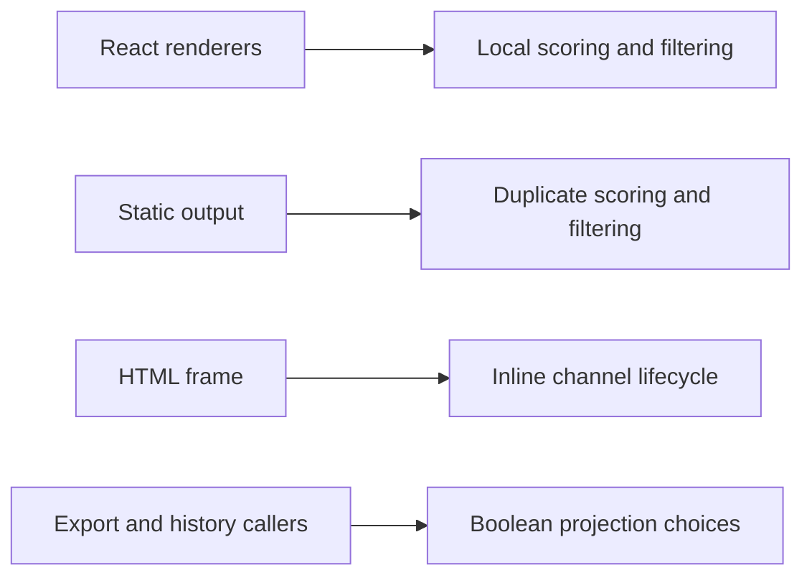
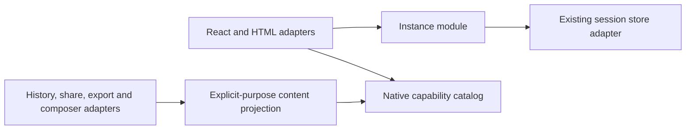

# Intelligent UI architecture and learning implementation plan

Date: 2026-10-10. Scope: the approved review fixes, three module improvements,
local HTML forms, flashcards and incorrect-answer practice. Preserve the current
working tree, dependencies, provider paths, v1 fences and existing session storage.

## Stage 1 — Regression baseline

Add failing cases before fixing: missing calculator operands, duplicate quiz
answers, invalid form option defaults/current values, lost provenance in static
output and an HTML runner that never becomes ready. Existing Intelligent UI tests
provide the compatibility baseline; passing those tests alone does not cover the
identified gaps.

## Stage 2 — Instance and HTML

Own eligibility, identity, epochs, reset and disposal in the instance module.
Require runner readiness within five seconds; expose starting/active/failed states
and user-triggered retry. Preserve the store's atomic commit guard and write queue.
Permit local forms and associated controls while preventing navigation. Test
timeouts, errors, late events, reset, disabled settings, session switches, local
submit/reset handlers and scriptless previews. No automatic form-state harvesting.

## Stage 3 — Native capabilities and projections

Use a static capability catalog for schemas, state normalization, validation,
derived results and prompt descriptions. Keep React adapters separate. Centralize
explicit-purpose projections for model history, original/current static content,
result drafts and edit drafts. Share scoring/filter/chart rules, preserve provenance,
localize host messages and exclude private state by default. Test invalid definitions,
invalid restored state and agreement between interactive and projected results.

## Stage 4 — Learning

Add v1 flashcards with stable IDs, front/back content, revealed state and latest
self-ratings. Extend quizzes with all/incorrect practice, current answers and latest
per-question submitted answers. Keep only current progress and recent results within
the current session. Test reveal-before-rating, navigation, retry subsets, repeated
submissions, legacy restoration, temporary storage and opt-in static exports.

## Stage 5 — Integration and documentation

Test the real Connected/store seam and parser-validated prompt examples. Measure
parser repetition with synthetic long answers before considering a parser rewrite.
Update user docs, bilingual README, domain vocabulary, and a temporary HTML report
with before/after diagrams. Run imports, formatting, artifact hygiene, ESLint,
TypeScript, full Vitest, Next production build and Cloudflare Worker build.

No E2E, real-provider calls, commit, deployment or new output-size gate is authorized.
Browser isolation/navigation, visual/accessibility and deployment acceptance remain
separate from local unit tests. Do not claim an iframe gives hard CPU isolation.

## Ownership

- Native catalog/learning: definitions, capabilities, native rendering and tests.
- Instance/forms: runtime identity, channel, host card, state commit guards and tests.
- Projection/localization: public projection interface, consumers, translations and tests.
- Primary: integration, prompt examples/evaluation, docs, architecture report and validation.

Each implementation agent adds scoped regressions and reports results; the primary
reviews the combined interfaces and validates the whole project before completion.

## Parser measurement (no optimization gate)

Measured the existing parser locally under Node 24.21.0 / Vitest 5.0.3 with
synthetic prose interleaved with complete checklist blocks. Every 512-character
chunk reparsed the accumulated prefix; each scenario ran three times. Results
include parsing, schema validation and initial projection, not browser rendering.

| Blocks | Characters | Parse calls | Total time per run (ms) |
| ------ | ---------- | ----------- | ----------------------- |
| 1      | 100,138    | 196         | 6, 5, 5                 |
| 20     | 102,979    | 202         | 12, 7, 7                |
| 50     | 106,799    | 209         | 17, 17, 15              |

This small synthetic sample is not a production latency guarantee. There is no
current evidence requiring a completed-block cache; retain the current parser
and measure real browser workloads before changing streaming semantics. The
one-off measurement test was removed after recording results; no benchmark or
output-size gate was added.

## Architecture before and after

The instance module owns startup/identity/disposal; the store remains authoritative
at commit. The catalog owns capability semantics; React owns presentation. The
projection module owns content/privacy/localization choices. Adding a native kind
requires its capability, renderer adapter and catalog entry, without duplicating
scoring in exports. No provider, Research evidence or backup protocol was replaced.

## Implementation and review outcome

All five scoped audit defects were reproduced before fixes: missing scale operands,
duplicate quiz answers, invalid form option defaults, missing static provenance,
and the unresponsive runner. Regression coverage now exercises the shared domain
and actual Connected/store adapters, plus Card/iframe transport in JSDOM.

The independent integration review identified additional invalid-value edges:
wrong-type empty defaults, explicit null operands and numeric step alignment.
These are fixed with focused schema/runtime regressions. Numeric constraints use
`min` as the step base, or zero when no minimum is specified; omitted step leaves
fractional values unrestricted by host validation. Source references now survive
edit drafts and missing-definition fallbacks as well as ordinary projections.

Prompt fixtures cover all seven native kinds, prose, quoted protocol examples
and the complete local HTML form. They validate the actual parser and HTML policy;
no real-model evaluation was performed. Learning state stores only the current
round/progress and latest results, following the existing session, branch,
backup, temporary-session and opt-in sharing rules.

Three implementation agents owned independent native, instance and projection
modules. A separate read-only reviewer checked the integrated seams; the primary
integrated changes, maintained docs/prompts and ran project-level validation.

## Final local validation — 2026-10-10

- `check:imports`, `hygiene:artifacts`, `format:check`, `lint` (no warnings),
  and `typecheck`: passed.
- `test`: **422 files / 2,933 tests passed** after the final integrated fixes.
- `build`: passed; `/intelligent-ui/sandbox` is included as a dynamic route.
- `build:worker`: passed with Next.js 16.3.5 and OpenNext Cloudflare 1.20.1.
- Existing Next.js middleware-convention deprecation remains; no unrelated
  middleware migration was included.
- No E2E/browser, real-provider requests, deployment or git commit was performed.
  No preview/background service or Docker image was created. Test/build processes
  completed and exited. Browser isolation, navigation, accessibility/layout and
  deployed header validation remain separate release acceptance requirements.
